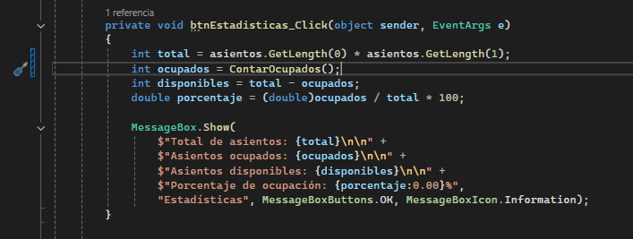
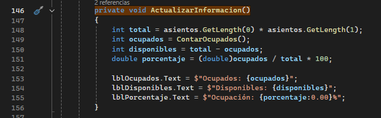
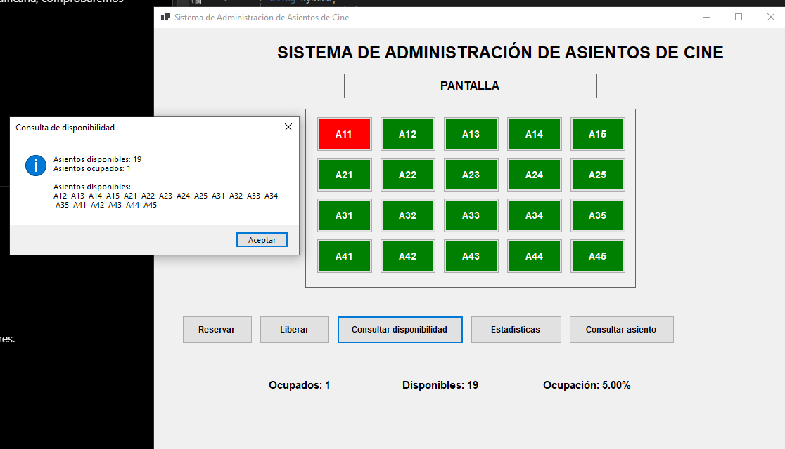
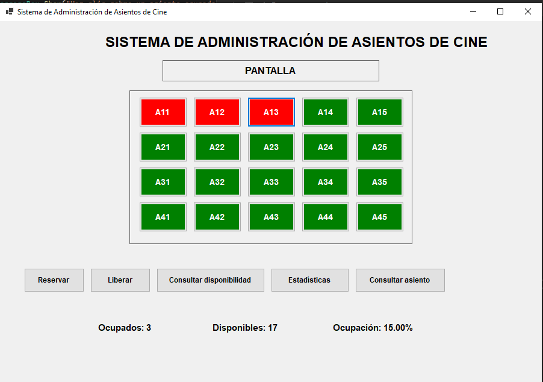
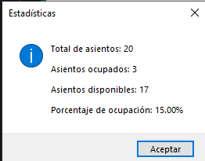
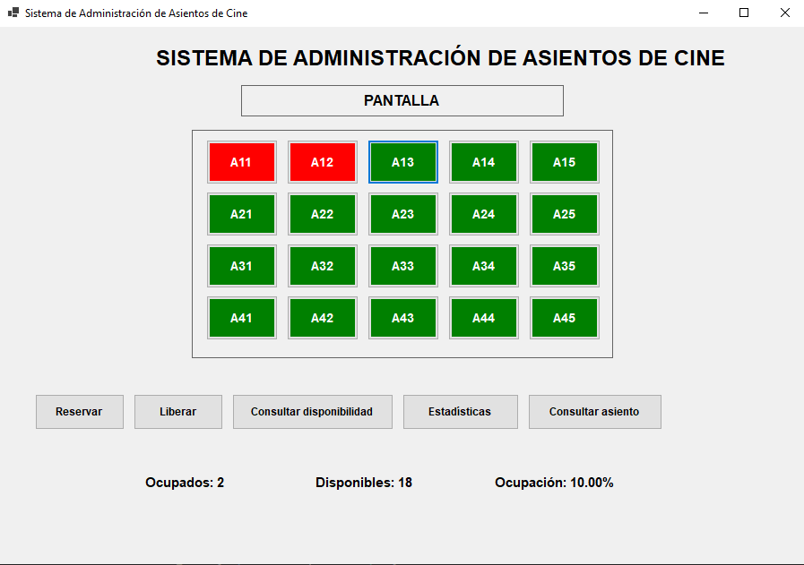
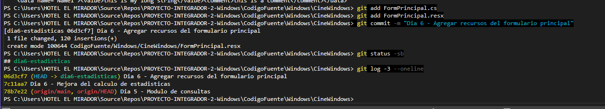

# Día 6 - Implementación de estadísticas

**Materia:** Estructura de Datos  
**Grupo:** 501  
**Proyecto:** Sistema de Administración de Asientos de Cine  
**Integrantes:** Hugo Reyes Alvarez y Joan Manuel Becerril Reyes

## Objetivo

Continuar con el programa que se trabajó en el Día 5 y revisar las estadísticas de la sala. El objetivo fue comprobar que el sistema mostrara bien la cantidad de asientos ocupados, disponibles y el porcentaje de ocupación.

## Trabajo realizado

Abrimos la versión del Día 5 de nuestro compañero en Visual Studio 2022. Esta versión tiene una matriz de **4 filas y 5 columnas**, es decir, **20 asientos**. Conservamos esa versión para realizar el Día 6.

El programa ya podía contar los asientos y mostrar estadísticas. Al revisar el método del botón **Estadísticas**, notamos que el total estaba escrito directamente como `20`. Cambiamos esa parte para que el total se obtenga del tamaño de la matriz:

```csharp
int total = asientos.GetLength(0) * asientos.GetLength(1);
int ocupados = ContarOcupados();
int disponibles = total - ocupados;
double porcentaje = (double)ocupados / total * 100;
```

`GetLength(0)` obtiene las filas y `GetLength(1)` las columnas. Con esto ya no hay que escribir el total a mano. El método `ActualizarInformacion()` ya usaba ese cálculo para actualizar las etiquetas de la pantalla, por lo que no fue necesario cambiarlo.



*Captura 1. Modificación del cálculo del total en el botón Estadísticas.*



*Captura 2. Método que actualiza los números que aparecen en la ventana principal.*

## Pruebas realizadas

Primero reservamos un asiento y el sistema mostró **1 ocupado, 19 disponibles y 5 % de ocupación**.



*Captura 3. Consulta con un asiento ocupado.*

Después reservamos A11, A12 y A13. Las etiquetas indicaron **3 ocupados, 17 disponibles y 15 % de ocupación**. También presionamos el botón **Estadísticas** y el mensaje mostró los mismos resultados.



*Captura 4. Tres asientos reservados.*



*Captura 5. Resultados del botón Estadísticas.*

Por último, liberamos A13. Regresó a color verde y el sistema actualizó los datos a **2 ocupados, 18 disponibles y 10 % de ocupación**.



*Captura 6. Estadísticas después de liberar A13.*

## Avance en Git

Trabajamos en la rama `dia6-estadisticas`, conservando los cambios del Día 5. Guardamos el ajuste del cálculo y el archivo de recursos `FormPrincipal.resx` en dos commits:

- `7c11aa7` - Dia 6 - Mejora del calculo de estadisticas.
- `06d3cf7` - Dia 6 - Agregar recursos del formulario principal.



*Captura 7. Registro de los cambios en Git.*

## Conclusión

En el Día 6 comprobamos que las estadísticas cambian correctamente cuando reservamos o liberamos asientos. También mejoramos el cálculo del total para que dependa del tamaño de la matriz y no de un número escrito a mano. Mantuvimos el avance del Día 5 y dejamos los cambios guardados en nuestra rama para integrarlos al repositorio.

**Nota:** Esta documentación corresponde únicamente al avance del Día 6; no reemplaza el PDF técnico final que solicita el profesor.
